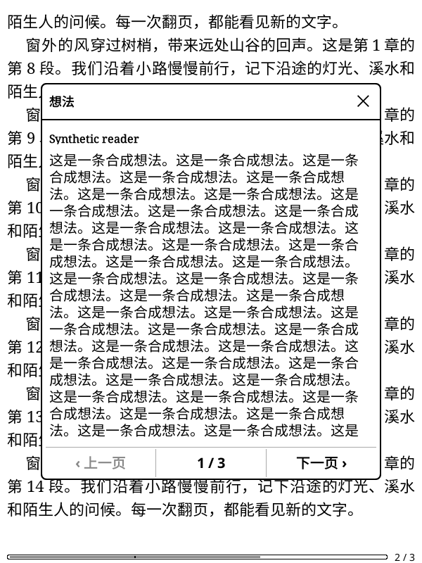
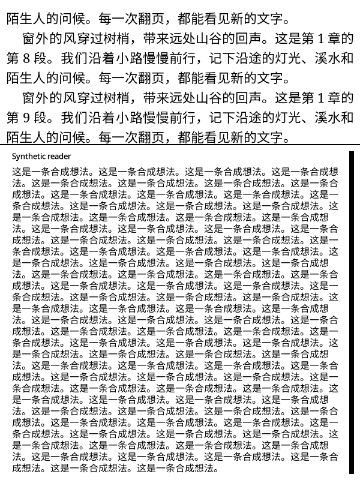

# Thought popup screenshot gesture investigation (2026-10-31)

Baseline: fork `4afb5d3138d23298a6b0451d0a341419ebf229cd`.

The [upstream report](https://github.com/finlater/weread.koplugin/issues/209)
describes a custom bottom-right single-tap screenshot binding closing the
thought popup. That binding is scoped to ReaderUI's gesture plugin, not the
always-active native Screenshoter. Forwarding arbitrary popup input to the
reader would also enable unrelated reader actions. This change does **not**
claim to fix or change that custom single-tap behavior.

Investigation found a separate, independently testable defect: both centered
and bottom thought popups consume diagonal swipes starting inside their
painted bounds, preventing KOReader's native long-diagonal screenshot gesture.
The scroll child already passes diagonal swipes through. The outer widgets
must do the same, like KOReader's native FootnoteWidget. Cardinal-direction
paging, scrolling and dismissal remain unchanged.

The routing was checked against the local KOReader source at
`675f467b186f9a1613719cac15e597a6c6eed0fa`:

- `frontend/ui/uimanager.lua:1026`: a handled top-window event stops routing.
- `frontend/ui/uimanager.lua:1052`: unhandled events reach active widgets.
- `frontend/apps/reader/readerui.lua:241`: Screenshoter is registered active.
- `frontend/ui/widget/screenshoter.lua:23`: native long-swipe screenshot range.
- `frontend/ui/widget/footnotewidget.lua:473`: diagonal swipes intentionally propagate.

## Verification

- Existing plus new navigation spec: 93 checks; replacing only the two
  production files with baseline versions gives 8 failing assertions
  (four diagonal directions inside each popup). Fixed files pass all 93.
- All seven `spec/thought_popup*_spec.lua` files pass: 292 checks.
- Namespace check, secret scan, changed-file LuaJIT syntax checks, release
  package/archive validation and `git diff --check` pass.
- `spec/emulator/scenarios/09_annotations_thoughts.lua` now exercises a real
  Gesture event through UIManager and the native Screenshoter for both popup
  positions, checks that a PNG is saved and the popup remains open. The
  screenshot directory is confined to the scenario evidence directory.
- Fork emulator `v2026.10.q1_emulator`, 600×800: scenario 09 passed all
  eight steps in 8.3 seconds after supplying the host's missing SDL3 library.
  Native screenshot PNGs were produced for both popup positions and visually
  inspected. This is a focused fork-emulator pass, not an official-runtime,
  complete release integration or physical-device acceptance result.
- Real negative controls reverted only the centered handler, then only the
  bottom handler. They failed waiting for the respective native screenshot;
  the bottom negative first successfully captured the centered popup. Both
  production fixes were restored after the controls.
- The first integration attempt used a short thought, causing the centered
  popup to shrink so the geometric swipe was too short. The scenario now uses
  long synthetic text and asserts the actual distance against the native
  threshold before dispatch. It does not forge an impossible swipe length.

| Native screenshot: centered | Native screenshot: bottom |
| --- | --- |
|  |  |

Runtime screenshot module SHA-256:
`5c2da946e9ae2f23ccdf6849304fe0056bdc8128658e2ea57b901a4240c95b45`.
Runtime UIManager SHA-256:
`4d671b1251c6a9df4848751b0453dddd2892ae088287c03d1bd15f7c81aac0fe`.

No upstream contact, account access or API behavior changes are involved.
